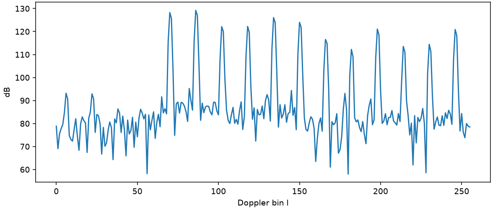
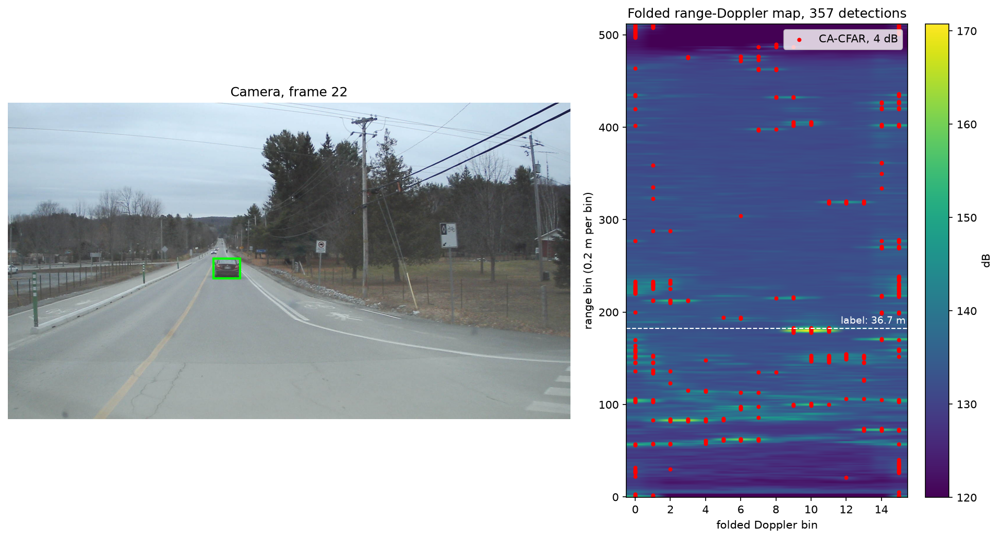
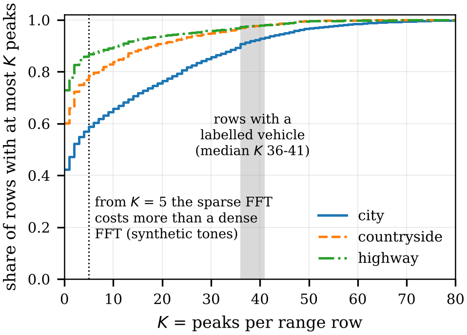
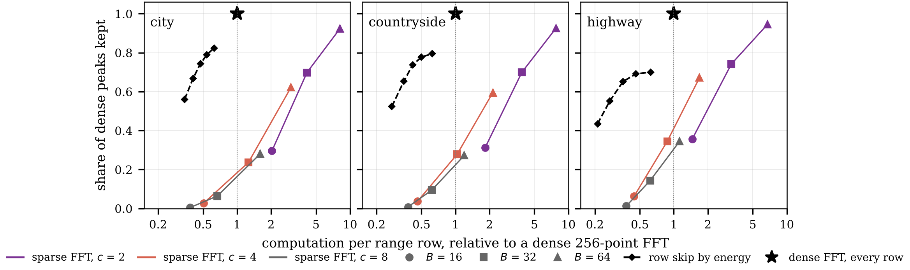

# Sparse FFT on Real Radar

**Is a real high-definition automotive radar sparse enough for the sparse Fourier transform?**

A sparse FFT can beat the ordinary FFT when a spectrum has only a few nonzero bins. Radar looks like a natural fit: a Doppler spectrum should hold a few moving targets and little else. I tested that idea on real data. Starting from the raw ADC files of the [RADIal](https://github.com/valeoai/RADIal) dataset, I built the radar processing chain, measured how sparse the Doppler spectra are, implemented a sparse FFT, and compared it with the dense FFT it would replace.

**Short answer: no, not at this size.** Most range rows are sparse, but those are the empty ones. A row that contains a vehicle holds about 36 to 41 Doppler peaks, and on real rows the sparse FFT kept fewer peaks than a dense 256-point FFT or a simple row skip at every computation cost.

Reports:
- [Short paper, 3 pages (PDF)](reports/Daksh_Shah_SparseFFT_RADIal_short.pdf)
- [Extended technical report, 12 pages (PDF)](reports/Daksh_Shah_SparseFFT_RADIal_extended.pdf)

## Contents

- [Background](#background)
- [What is in this project](#what-is-in-this-project)
- [Findings](#findings)
- [What did not go as expected](#what-did-not-go-as-expected)
- [Repository layout](#repository-layout)
- [Getting the data](#getting-the-data)
- [Reproducing the results](#reproducing-the-results)
- [Limitations and next steps](#limitations-and-next-steps)
- [References](#references)

## Background

**The radar.** RADIal was recorded with a high-definition automotive radar with 12 transmitters and 16 receive channels. One frame is a cube of 512 samples × 256 chirps × 16 channels. A range FFT along the samples and a Doppler FFT along the chirps turn it into a range-Doppler map. One range bin is about 0.2 m.

**Why the Doppler FFT.** The Doppler stage runs one 256-point FFT for every range bin and channel: 8192 FFTs per frame, about 47% of all FFT multiplications in the chain. A cheaper Doppler transform would matter on an FPGA.

**DDM.** The 12 transmitters send at the same time and are separated by Doppler-division multiplexing. Each target therefore appears 12 times along Doppler, exactly 16 bins apart. This one property decides most of the results below.



*Doppler spectrum (dB against Doppler bin) of one range row that contains one vehicle. The vehicle appears as 12 copies.*

**The sparse FFT.** I implemented the exactly-sparse algorithm of Hassanieh, Indyk, Katabi and Price (STOC 2012). One round does this:

1. Read the samples in steps of a random odd number σ. This moves every tone from bin f to bin σf without any FFT.
2. Multiply by a window whose spectrum is flat over a band of neighbouring bins, fold the result to B values, and take one small B-point FFT. This gives B buckets, each the sum of one band.
3. Do the same with the samples shifted by one. If a bucket holds a single tone, the phase between its two values gives the tone's exact bin.
4. Subtract the tones found and repeat with a new σ.

## What is in this project

- **A radar chain written from the raw files.** Event-log parser, block reader, frame assembly from four radar chips, Hamming windows, range and Doppler FFTs, DDM folding and CA-CFAR detection. Checked against the dataset's vehicle labels and camera images.
- **A sparsity study** on three driving scenes (city, countryside, highway), with a noise control and a separate measurement for rows that contain a labelled vehicle.
- **A sparse FFT implementation** (`src/sfftradar/sfft.py`): permutation, flat window design, hashing into buckets, tone location with collision checks, the full loop, a multi-channel version for real radar rows, and an operation-count model.
- **A comparison on real rows** against the dense FFT and against an energy-based row skip, with two robustness checks.
- **Two reports** and a working log (`notes/log.md`) that records every number, mistake and decision.



*Check of the chain on one countryside frame. Left: camera image with the dataset's label box. Right: my range-Doppler map (Doppler folded over the DDM slots) with CA-CFAR detections in red and the labelled range of 36.7 m as a dashed line.*

## Findings

Scope: three sequences of one dataset and one radar, Doppler transform size N = 256.

### 1. Most range rows are sparse

For each range row I count K, the number of Doppler bins more than 10 dB above that row's median power. Pure noise passed through the same chain gives K = 0 in every row.

| Every 5th frame, all 512 rows | City | Countryside | Highway |
|---|---|---|---|
| Rows measured | 59,392 | 46,592 | 39,936 |
| Median K | 2 | 0 | 0 |
| 90th percentile of K | 36 | 18 | 11 |
| Rows with K = 0 | 42% | 60% | 73% |
| Rows with K ≤ 8 | 63.2% | 81.9% | 88.5% |



*Share of range rows with at most K Doppler peaks. The highway is the sparsest scene and the city the least sparse. The grey band marks rows with a labelled vehicle.*

### 2. Rows with a vehicle are not sparse

The sparse rows are the empty ones. In rows where the dataset labels a vehicle, the median K is 41 in the countryside (55 vehicles) and 36 on the highway (32 vehicles). None of these 87 rows had K ≤ 8. The number is what DDM predicts: 12 copies, each about 3 bins wide after the Hamming window.

So a sparse FFT has to be compared with a much simpler idea as well: do not transform empty rows at all.

### 3. At N = 256 the sparse FFT is cheaper only for very few tones

Counting complex multiplications, a dense 256-point FFT costs 1024. One round of the sparse FFT costs 378 with 16 buckets, because the flat window alone reads 141 of the 256 samples in each of its two hashings.

| Noise-free synthetic tones: share recovered / multiplications | K = 1 | K = 5 | K = 12 | K = 36 |
|---|---|---|---|---|
| 16 buckets | 1.00 / 378 | 1.00 / 1512 | 0.93 / 4536 | 0.00 / 4536 |
| 32 buckets | 1.00 / 546 | 1.00 / 1638 | 1.00 / 6552 | 0.00 / 6552 |
| 64 buckets | 1.00 / 862 | 1.00 / 2586 | 1.00 / 10,344 | 0.91 / 10,344 |

The sparse FFT wins for one tone and already loses for five. A row with 36 tones, the vehicle case, costs about ten times the dense FFT and still fails in 9% of trials.

### 4. On real rows it loses to both alternatives

A dense peak is a local maximum more than 10 dB above the row median. It counts as kept if the sparse output finds it within one bin.

| Peaks kept / cost relative to a dense FFT | City | Countryside | Highway |
|---|---|---|---|
| Sparse FFT, 16 buckets | 3% / 0.51 | 4% / 0.46 | 7% / 0.46 |
| Sparse FFT, 32 buckets | 24% / 1.29 | 27% / 0.98 | 35% / 0.85 |
| Sparse FFT, 64 buckets | 61% / 2.99 | 60% / 2.12 | 70% / 1.70 |
| Dense FFT only on rows above the median row energy | 82% / 0.62 | 79% / 0.62 | 70% / 0.62 |
| Dense FFT on every row | 100% / 1.00 | 100% / 1.00 | 100% / 1.00 |



*Share of dense Doppler peaks kept against computation per range row, for three detection thresholds c and three bucket counts B. In every scene the sparse FFT lies below and to the right of the dense FFT (star) and the energy-based row skip (dashed).*

A lower detection threshold lets the sparse FFT keep 92% to 95% of the peaks, but at 6.7 to 8.1 times the dense cost. No setting keeps most peaks for less than a dense FFT.

### Why it loses

1. **Too many peaks where it matters.** A row with a vehicle holds about 36 peaks because of DDM.
2. **Buckets collect noise.** A bucket sums 16 neighbouring bins when 16 buckets are used, so it also sums 16 bins of noise. That is 12 dB more noise against the same peak, and a peak 10 dB above the floor disappears. This effect does not show up in noise-free tests.
3. **The window is long.** At N = 256 the flat window reads more than half of the samples in every hashing. The speed-up of sparse FFTs is for much larger transforms.

## What did not go as expected

- **My first sparsity measure ranked the scenes backwards.** K90, the number of bins holding 90% of the energy, called the city the sparsest scene (5.3% of bins) and the highway the least sparse (46.1%). It measures how energy splits between peaks and noise floor, not how many peaks there are. Counting peaks per row fixed it.
- **Plain subsampled buckets cannot work on this radar.** Keeping every 16th sample adds exactly the bins that are 16 apart, so all 12 DDM copies of a target fall into one bucket. The band-shaped buckets of the flat window are needed.
- **The synthetic version found nothing useful on real rows.** It needed all 16 channels processed together and a threshold relative to the noise in the buckets.
- **Skipping empty rows is not free either.** I assumed it would keep every peak. A realistic version, based on row energy, loses 18% to 30% of the peaks, because weak peaks sit in low-energy rows.
- **Labels and radar disagree on the highway.** The radar sees the labelled vehicle about 1.8 m beyond the labelled range. It does not affect the sparsity results and is still unexplained.

## Repository layout

```
src/sfftradar/
  radial.py      event log parser, raw block reader, frame cube, labels
  rd.py          windows, range-Doppler map, folded map, CA-CFAR
  sparsity.py    K90, peaks per range row, noise control, peak finder
  sfft.py        flat window, hashing, tone location, sparse FFT, cost model
  evaluate.py    peaks kept by the sparse FFT on one range row
notebooks/
  01_loader.ipynb            chain from raw data, CFAR, labels, camera pairing
  02_check_sequences.ipynb   the same check on another sequence
  02_sparsity.ipynb          sparsity measurements (findings 1 and 2)
  03_sfft.ipynb              tests of each sparse FFT step, synthetic sweep (finding 3)
  04_real_rows.ipynb         sparse FFT on real rows and both checks (finding 4)
results/         saved per-row peak counts and real-row results
figures/         figures made by the notebooks
reports/         both reports (LaTeX and PDF), print figures, make_figures.py
notes/log.md     working log
```

## Getting the data

The radar data is not in this repository. Download the sequences from the [RADIal page](https://github.com/valeoai/RADIal) and place them like this:

```
data/
  labels_CVPR.csv
  RECORD@2020-11-21_13.46.26/RECORD@2020-11-21_13.46.26/...   city, 576 frames
  RECORD@2020-11-22_12.54.38/RECORD@2020-11-22_12.54.38/...   countryside, 452 frames
  RECORD@2020-11-22_12.38.47/RECORD@2020-11-22_12.38.47/...   highway, 388 frames
```

Each sequence needs its four radar `.bin` files and the events log. `01_loader.ipynb` also needs the camera file. Set `ROOT` in `src/sfftradar/radial.py` to your `data` folder.

## Reproducing the results

Requires Python 3 with NumPy, SciPy, Matplotlib, pandas, OpenCV and Jupyter:

```
git clone https://github.com/PLANETORIAN/Sparse-FFT-Radar.git
cd Sparse-FFT-Radar
pip install -r requirements.txt
```

| Result | Run | Needs the radar data |
|---|---|---|
| Findings 1 and 2, `results/k_rows.npz` | `notebooks/02_sparsity.ipynb` | yes |
| Finding 3 and the tests of each algorithm step | `notebooks/03_sfft.ipynb` | no |
| Finding 4, `results/phase3_*.npy` | `notebooks/04_real_rows.ipynb` | yes |
| The figures on this page | `python reports/make_figures.py` | no |

## Limitations and next steps

- Three sequences of one dataset and one radar. The real-row comparison uses every 25th frame.
- K depends on its threshold. At 6 dB instead of 10 dB the share of rows with K ≤ 8 drops by about 20 points. The ranking of the scenes stays the same.
- The vehicle-row result rests on 55 and 32 labelled vehicles. The city sequence left too few usable labels. Static clutter is not removed.
- I tested the exactly-sparse algorithm. Noise-tolerant sparse FFTs may keep more peaks at a higher cost.
- Cost is a count of complex multiplications. No FPGA design was synthesised.

What I would do next:
- **A DDM-aware sparse transform** that treats the 12 copies of a target as one, since their spacing is known.
- **A two-dimensional transform** over range and Doppler, where the transform is large enough for sparse methods to have room.
- **An HLS implementation** of the dense FFT, the row skip and one sparse stage, to replace the operation count with measured FPGA cost.

## References

- J. Rebut, A. Ouaknine, W. Malik, P. Pérez, "Raw High-Definition Radar for Multi-Task Learning," CVPR 2022, pp. 17021-17030.
- H. Hassanieh, P. Indyk, D. Katabi, E. Price, "Nearly Optimal Sparse Fourier Transform," STOC 2012, pp. 563-578.
- H. Hassanieh, P. Indyk, D. Katabi, E. Price, "Simple and Practical Algorithm for Sparse Fourier Transform," SODA 2012, pp. 1183-1194.

## Author

Daksh Shah, Department of Electrical Engineering, NIT Rourkela.
Contact: daksh06shah2006@gmail.com

The RADIal dataset belongs to its authors and is distributed under its own terms; this repository contains none of its data.
